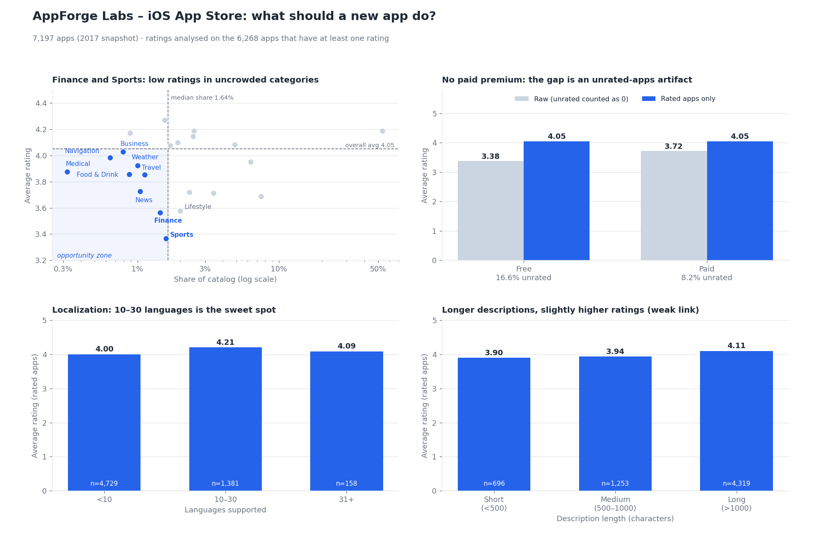

# AppForge Labs – iOS App Store Strategy Analysis

**Recommendation:** enter the **Finance** category (with **Sports** as the validation candidate), localize into **10–30 languages**, and do not count on a paid price to lift ratings.

| | |
|---|---|
| **Role** | Data analyst (portfolio project) |
| **Tools** | SQL (SQLite), Python (pandas, SciPy, matplotlib) |
| **Data** | 7,197 iOS apps from a 2017 Kaggle snapshot (apps table + descriptions table) |

> **Note:** AppForge Labs is a fictional company. The analysis is real, the business scenario is a framing device.



---

## 1. Business context

AppForge Labs is a hypothetical studio about to build its first iOS app. Leadership asked three questions:

1. **Which category** should we enter?
2. **How should we price** the app (free or paid)?
3. **What drives higher user ratings?** (localization, description length)

## 2. North-star metrics

| Question | Metric |
|---|---|
| Category | **Category opportunity**: a genre qualifies if it has ≥ 10 rated apps, an average rating below the overall average (4.05) **and** a share of the catalog below the median genre share (1.64%). 9 genres qualify. |
| Pricing | Average rating of paid vs free apps, **rated apps only** |
| Ratings drivers | Average rating by language bucket and by description-length bucket |

## 3. Data and cleaning

- 7,197 apps, 7,197 unique ids, one description per app.
- **929 apps (12.9%) have no ratings**, and for them `user_rating = 0` means "no data", not "terrible". They are excluded from every rating average (6,268 rated apps remain) but kept for share-of-catalog counts.
- Genres need at least 10 rated apps to be compared (this excludes *Catalogs*: 10 apps, 5 rated).
- Full log in [`provenance.md`](provenance.md).

## 4. Executive summary

1. **Finance is the clearest opening.** It averages 3.56 (overall 4.05) while holding only 1.4% of the catalog, and its apps still collect about 16,000 ratings each, so users are engaged.
2. **A paid price does not buy better ratings.** Paid and free apps both average 4.05 (Welch p = 0.89). The raw gap (3.72 paid vs 3.38 free) comes from 16.6% of free apps having no ratings versus 8.2% of paid apps.
3. **Supporting 10–30 languages goes with the best ratings** (4.21, versus 4.00 below 10 languages). This is correlational and probably reflects app maturity.
4. **Longer descriptions go with slightly higher ratings** (4.11 above 1,000 characters vs 3.90 below 500), but the link is weak: Pearson r = 0.11.
5. **The catalog is dominated by Games and Entertainment** (61% of all apps). Games rate well (4.19) but are the most crowded space.

## 5. Key insights

### 5.1 Category opportunity

Nine genres meet all three criteria:

| Genre | Apps | Rated | Share of catalog | Avg rating | Avg ratings per app |
|---|---:|---:|---:|---:|---:|
| Sports | 114 | 101 | 1.6% | 3.37 | 15,832 |
| **Finance** | 104 | 71 | 1.4% | 3.56 | 16,182 |
| News | 75 | 60 | 1.0% | 3.73 | 16,269 |
| Travel | 81 | 71 | 1.1% | 3.85 | 16,120 |
| Food & Drink | 63 | 52 | 0.9% | 3.86 | 16,887 |
| Medical | 23 | 20 | 0.3% | 3.88 | **682** |
| Weather | 72 | 66 | 1.0% | 3.92 | 24,197 |
| Navigation | 46 | 31 | 0.6% | 3.98 | 17,590 |
| Business | 57 | 53 | 0.8% | 4.03 | **5,149** |

How to read it:

- **Finance over Sports is a judgment call.** Sports has the lowest rating (3.37) but sits right at the saturation threshold (1.58% vs a 1.64% median). Finance is slightly less crowded (1.4%) and its low rating has a clear hypothesis (users expect trust and accuracy from money apps). Sports is the validation candidate.
- **Medical looks attractive but is not.** Only 682 ratings per app means very little user engagement. Low saturation alone is not demand, which is why rating volume is checked next to the rating.
- **Lifestyle is not an opportunity** under this definition. It rates low (3.58) but holds 2.0% of the catalog, above the median.
- Inside Finance, paid apps rate higher (4.16, n = 16) than free ones (3.39, n = 55). The paid group is too small to support a pricing decision.

### 5.2 Paid vs free

| | Free | Paid |
|---|---:|---:|
| Rated apps | 3,383 | 2,885 |
| **Avg rating (rated only)** | **4.05** | **4.05** |
| Raw avg rating (unrated counted as 0) | 3.38 | 3.72 |
| Share of apps with no ratings | 16.6% | 8.2% |
| Median ratings per app | 1,033 | 259 |

Once unrated apps are removed the difference disappears. Paid apps also collect far fewer ratings (median 259 vs 1,033), so a paid model means slower feedback.

### 5.3 Localization

| Languages supported | Apps | Avg rating | Median ratings per app |
|---|---:|---:|---:|
| < 10 | 4,729 | 4.00 | 336 |
| **10–30** | 1,381 | **4.21** | 1,701 |
| 31+ | 158 | 4.09 | 3,497 |

The 31+ group is small (158 apps), so treat its figure with care. Apps with more languages also have far more ratings, which suggests this reflects mature, well-resourced products rather than a pure localization effect.

### 5.4 Description length

| Description length | Apps | Avg rating |
|---|---:|---:|
| Short (< 500 chars) | 696 | 3.90 |
| Medium (500–1,000) | 1,253 | 3.94 |
| Long (> 1,000) | 4,319 | 4.11 |

Pearson r = 0.11 (p < 0.001, n = 6,268); Spearman ρ = 0.08. The relationship is statistically significant because the sample is large, but length explains only about 1% of the variation in ratings.

## 6. Recommendations

| # | Action | Owner | Success metric |
|---|---|---|---|
| 1 | Prioritize **Finance** for the first app; validate against **Sports** and **News** with a short user-interview round | Product | Pick one category by end of discovery |
| 2 | Study the leading Finance app as a benchmark (Credit Karma: 5.0 stars, 101,679 ratings) and list what it does that average apps do not | Product / Design | Written gap analysis |
| 3 | Launch **free**; treat paid pricing as a later experiment, not a quality signal | Product | Average rating ≥ 4.0 after the first 100 ratings |
| 4 | Plan localization for **10–30 languages**, phased by market, and test the effect rather than assuming it | Growth | Rating by locale after launch |
| 5 | Write a complete store description (above 1,000 characters) but do not expect it to move ratings much | Marketing | Conversion rate on the listing page |

## 7. Limitations

- **Observational data, 2017 snapshot.** The store has changed since; these are associations, not causal effects.
- **Ratings are rounded to 0.5 steps** in the source, and genre averages treat every app equally (not weighted by number of ratings).
- **Rated apps only.** Apps without ratings are excluded from rating averages, which can hide very new or unpopular apps.
- **Small groups:** Finance paid apps (16), 31+ languages (158) and several genres have limited samples.
- **Correlation is not strategy.** Localization and description length may be symptoms of well-funded teams.

## 8. Repository files

| File | What it is |
|---|---|
| `README.md` | This report |
| `dashboard.png` | Summary dashboard |
| `analysis_queries.sql` | All SQL: paid vs free, languages, categories, descriptions, benchmarks |
| `build_db.py` | Loads the two Kaggle CSVs into a SQLite database |
| `analysis_stats.py` | p-value, correlations and median cross-checks |
| `make_dashboard.py` | Builds `dashboard.png` |
| `provenance.md` | Data checks and cleaning log |
| `requirements.txt` | Python packages needed |

## 9. How to reproduce

1. Download the dataset from Kaggle and put `AppleStore.csv` and `appleStore_description.csv` in the same folder as these files.
2. Run:

```bash
pip install -r requirements.txt
python build_db.py            # creates appforge.db
python analysis_stats.py      # p-value and correlations
python make_dashboard.py      # regenerates dashboard.png
```

3. Open `appforge.db` in any SQLite tool (SQLite 3.25+ needed for window functions) and run the queries in `analysis_queries.sql` one at a time.

---

*Portfolio project. Not financial or business advice.*
